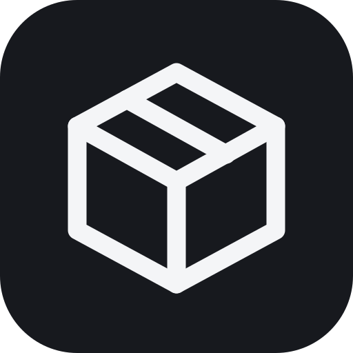

<p align="center"></p>

# NEX — Nekomo Extension Exchange

NEX is an open-source Android, Android TV and Google TV app from the Nekomo community. It manages the **repositories, extensions, plugins, sources and APIs** that other apps use. NEX is not a streaming or media app. It does not host or play anything, and it ships with **no third-party repositories**.

## Supported apps

Each app has its own adapter under `app/src/main/java/net/nekomo/nex/integrations/`. NEX only does what each app actually allows.

| App | Repository format | What NEX does |
| --- | --- | --- |
| **Nekomo** (`app.nekomo`, `.tv`, `.beta`, `.debug`) | `nekomoRepository` manifest (`repo/index.json`), plus the CloudStream / Zangetsu / Mihon / Aniyomi formats Nekomo reads | Detects all six packages. Browses and validates manifests and their linked repos, and imports manifest APIs. Checks and installs Nekomo app updates from `apks/latest.json` with SHA-256 verification. Repos are handed over with a `nekomo-repo://add?url=` link (Nekomo 2.8.1+), which opens Nekomo's own confirmation dialog; older versions get the URL copied. |
| **Mihon** | `index.min.json` | Detects installed extensions (`tachiyomi.extension` feature) and checks library compatibility. Installs, updates and uninstalls APKs through the system installer. Adds repos to Mihon with `tachiyomi://add-repo`. |
| **Aniyomi** | `index.min.json` (anime) | Same as Mihon, using the `tachiyomi.animeextension` feature and `aniyomi://add-repo`. |
| **CloudStream** | `repo.json` + plugin lists | Browses plugins and tracks versions. Hands the repo to CloudStream with `cloudstreamrepo://`. `.cs3` plugins live in CloudStream's private storage, so NEX can't install them itself. |
| **Zangetsu** (`com.spyou.watch_app`) | `index.json` (JS sources) | Browses and validates sources. Hands the repo over by copy or share, because Zangetsu has no add-repo link. |

### Known limitations
- Mihon's protobuf `index.pb` isn't parsed yet. Use the repo's `index.min.json`.
- CloudStream, Nekomo and Zangetsu keep plugins in app-private storage. NEX shows versions and updates for them, but you install from inside each app.
- Android always asks you to confirm installs and uninstalls. NEX never installs silently.

## Features
- **Home dashboard**: detected apps and versions, counts of installed extensions, updates and repositories, problems, and recent activity.
- **Extensions**: search, filter (installed, updates, available, problems), app filter, sort. Shows duplicate and incompatible states, and has a detail view with install, update, uninstall and app info.
- **Sources (repositories)**: add by URL (format and app are detected automatically, CloudStream shortcodes and `nex://add-repo?url=` work too), preview before adding, mark as trusted, enable or disable, rename, refresh, share, hand off to the target app, and spot duplicates and errors.
- **Updates**: manual and background checks (WorkManager), with configurable interval, Wi-Fi-only and notifications. Supports individual and bulk APK updates, the Nekomo app changelog, and an update history.
- **APIs & sources**: metadata, streaming and catalog endpoints with backup URLs and health checks. API keys are encrypted with an Android Keystore AES-GCM key and are never put in backups.
- **Backup and restore**: JSON export of repositories, APIs and settings. Restore also accepts a plain list of URLs.
- **Security**: HTTPS required by default, size limits and timeouts on downloads, and checks of SHA-256, package name, version code, required feature and signature (against the installed APK) before the system installer opens. Optionally blocks untrusted repositories.
- **Diagnostics**: rolling log file, device and network report, and cache and database sizes.
- **Android TV**: navigation rail, larger type, D-pad focus rings, a leanback launcher entry and a banner.
- First-launch legal and DMCA notice, which you can review again in Settings → About & legal.

## Building
Requirements: JDK 17 and Android SDK platform 35.

```bash
./gradlew :app:assembleDebug        # app/build/outputs/apk/debug/
./gradlew :app:testDebugUnitTest    # parser, URL and version tests
./gradlew :app:lintDebug
```

Release builds use a `release` signing config if you define one locally (never commit keystores). Otherwise they fall back to the debug key.

## Project layout
```
app/src/main/java/net/nekomo/nex/
  integrations/  IntegrationAdapter + one adapter per app, Formats (parsers)
  data/          Models, Room (db/), SettingsStore (DataStore), SecureStore (Keystore), NexRepository
  net/           NexHttp (OkHttp, cache, size limits)
  pkg/           PackageManager helpers, ApkInstaller (PackageInstaller sessions)
  work/          UpdateWorker (background checks + notifications)
  ui/            Compose UI: theme, components, screens/
```
For more detail, see [docs/ARCHITECTURE.md](docs/ARCHITECTURE.md) and [docs/INTEGRATIONS.md](docs/INTEGRATIONS.md).

## Legal
NEX is licensed under the [Apache License 2.0](LICENSE). It does not host, distribute or endorse any content. Repositories and extensions come from independent third parties, and you are responsible for what you add. Mihon, Aniyomi, CloudStream and Zangetsu are separate projects that are not affiliated with NEX. Copyright concerns about third-party content go to whoever hosts it. Issues with NEX itself go to [GitHub issues](https://github.com/Nekomo-App/NEX/issues).

## Links
- Nekomo community: https://github.com/Nekomo-App · https://nekomoapp.netlify.app
- Developer: MarshMeadow, https://github.com/marshmeadow2772 · https://marshmeadow.netlify.app
